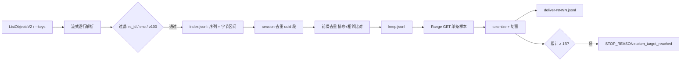

# 语料导出流水线（B2 → 1B token jsonl 分包）

`pipeline/corpus_pipeline.py`：把 B2 上的原始 Codex/Responses 抓包 jsonl 过滤、去重、切窗，导出成 1B token 的 SFT 语料（`deliver-NNNN.jsonl`）。

默认 **dry-run**：不带 `--execute` 只打印计划，不连网、不写盘。所有网络/写盘动作都在 `--execute` 之后。

## 一、锁定口径

| # | 口径 | 实现位置 |
| --- | --- | --- |
| 1 | 「100 轮」= `request.messages` 条数 ≥ 100 | `filter_reason()` / `--min-messages` |
| 2 | `encrypted_content` = `request.messages[].content[]` 中 `type=="encrypted_content"` 且非空的 part | `has_encrypted_content()` |
| 3 | `rs_id` = `response.response_data.output[].id` 以 `rs_` 开头 | `has_rs_id()` |
| 4 | session 去重：按 `session_id` 中 `~` 之前的 uuid 段分组，保留 `messages` 最长的一条 | `session_uuid()` / `session_dedup()` |
| 5 | token = tiktoken `o200k_base` + `encode_ordinary`，逐条 message 紧凑 JSON 单独计数后求和（**含密文**） | `count_message_tokens()` |
| 6 | 分片按体积 ~500 MB / 包；单条 > 128k token 按窗口切分 | `phase_emit()` / `split_windows()` |

去重顺序：**先 session（口径 4），再前缀**（kk 指定的顺序），两步移除量在账本里分开统计。

前缀去重是 messages **成员层面**：把每条 message 规范化（`sort_keys` 紧凑 JSON）后取 sha1 前 8 字节，拼成序列；所有序列按字节字典序排序，若某序列是相邻序列的**严格前缀**则丢弃（保留最长），O(n log n)，不建 Trie，不写 O(n²)。跨 session 生效（不比较 session_id）。完全相同的序列只保留一条。

## 二、三段式流程

```
index  →  流式读源对象（不落本地文件）→ 过滤 → 算 hash 序列 → 记录字节区间
plan   →  session 去重 → 前缀去重（排序 + 相邻比对）→ keep.jsonl + 账本
emit   →  按字节区间 Range GET 保留样本 → tokenize → 切窗 → 写分片，过 1B 即停
```



**为什么 index 不落源文件**：源文件最大 24.89 GiB，本机只剩 284 GiB。index 阶段边读边解析、只记 offset/len 与 hash 序列，磁盘只留索引（全量约 100 MB 级）。emit 阶段不再整文件下载，只对保留样本做 Range GET（1B token 约 10 GB 传输），全程磁盘占用由分片（约 6 GB）决定，**远低于 25 GiB**。

### 1B 止损有两道闸

1. **index 阶段（省下载时间）**：每处理完一个文件，用已索引记录做一次去重，按 `bytes × tokens_per_byte`（默认 0.1015，来自 astra-0009 全量实测）预估保留集 token；一旦 ≥ `target × 1.15` 就停止拉取新文件。这是"不要跑完全量再截断"的落点。
2. **emit 阶段（精确）**：累加器过 `--target-tokens` 立刻停；当前分片正常收尾，写 `STOP_REASON=token_target_reached` 到 `manifest.json`。

## 三、运行

```bash
# 0) 依赖（boto3 + tiktoken）
uv pip install boto3 tiktoken      # 或 pip install boto3 tiktoken

# 1) 干跑：只看计划，不连网不写盘
python pipeline/corpus_pipeline.py --keys Gpt-2026-10-18/gpt-6-astra-0009-20261001.jsonl
python pipeline/corpus_pipeline.py            # 前缀列举模式（计划里说明 --execute 才会列举）

# 2) 真跑（凭证走环境变量，不进仓库）
export B2_KEY_ID=...
export B2_APP_KEY=...
python pipeline/corpus_pipeline.py --execute --out-dir ./corpus_out

# 3) 分段跑（排查问题用）
python pipeline/corpus_pipeline.py --execute --phase index  --out-dir ./corpus_out
python pipeline/corpus_pipeline.py --execute --phase plan   --out-dir ./corpus_out
python pipeline/corpus_pipeline.py --execute --phase emit   --out-dir ./corpus_out

# 4) 换目标 / 重跑
python pipeline/corpus_pipeline.py --execute --target-tokens 2000000000 --out-dir ./corpus_out
python pipeline/corpus_pipeline.py --execute --reset --out-dir ./corpus_out
```

常用参数：

| 参数 | 默认 | 说明 |
| --- | --- | --- |
| `--keys` / `--keys-file` | 空 | 指定对象 key；都不给则按 `--prefix` 列举 |
| `--local-dir` | 空 | 本地目录模式（离线自测/复算），不连 B2 |
| `--max-records` | 0 | 每个文件最多扫多少条（自测用） |
| `--min-messages` | 100 | 口径 1 |
| `--target-tokens` | 1000000000 | 口径 5 的累计目标 |
| `--max-sample-tokens` | 128000 | 单条切窗阈值 |
| `--shard-bytes` | 524288000 | 单包体积上限 |
| `--tokenizer` | o200k_base | tiktoken 编码 |
| `--tokens-per-byte` | 0.1015 | index 阶段止损预估系数 |
| `--phase` | all | `index` / `plan` / `emit` / `all` |
| `--execute` | 关 | 不加以外一律 dry-run |

## 四、产物

```
<out-dir>/
  index.jsonl        # 过滤通过的记录：key/off/len/uuid/n_msgs/seq(hex)/order
  keep.jsonl         # 去重后的保留清单（emit 的输入）
  deliver-0001.jsonl # 交付分片，每条 = 原始记录（未切窗时原样字节）
  deliver-0002.jsonl
  emit.journal       # 逐行交付流水（id/key/shard/bytes/tokens），续跑与对账依据
  state.json         # 断点状态（index 已完成的 key、ledger、stop_reason）
  ledger.json        # 分文件账本：扫描/各过滤原因/两步移除/交付
  manifest.json      # 汇总：STOP_REASON、token 总数、分片清单、口径配置、closure 校验
```

`manifest.json` 关键字段：

```json
{
  "STOP_REASON": "token_target_reached | corpus_exhausted",
  "delivered_tokens": 1000000123,
  "delivered_samples": 2810,
  "kept_records": 2815,
  "not_delivered": 5,
  "shards": [{"file": "deliver-0001.jsonl", "samples": 380, "bytes": 500123456, "tokens": 135000000}],
  "ledger": {"scanned": 1234, "passed": 567, "session_removed": 0, "prefix_removed": 480,
             "filter_closure_ok": true},
  "dedup_closure_ok": true
}
```

对账关系（`ledger.json` 按文件可逐一对上）：

```
scanned = parse_error + no_session_id + no_rs_id + no_encrypted_content + too_short + passed
passed  = session_removed + prefix_removed + kept_records
kept    = delivered_records + not_delivered
```

超过 128k token 的单条会被切成多行，切开的行带 `_window` 字段：

```json
{"session_id": "…", "request": {"messages": [...]}, "_window": {"index": 0, "of": 3,
 "source": {"key": "Gpt-2026-10-18/xxx.jsonl", "off": 123}, "messages_total": 1234,
 "oversize_message": 0}}
```

未切窗的记录原样输出（字节不变），不带 `_window`。

## 五、中断与恢复

- 三阶段都可重入：**重跑同一条命令即可**，进度都在 `state.json` + `emit.journal`。
- `index`：已完成的 key 记在 `state.json`，跳过不重扫；续跑且目标提高时会自动清掉上一轮提前止损标记，继续拉新文件。
- `plan`：秒级，幂等，重跑覆盖 `keep.jsonl`。
- `emit`：以 `emit.journal` 为准重建分片账本——启动时把分片尾部**未入账的半行截断**，已交付的 `id` 不会重复写；最后一个分片未满则继续追加，满了才开新片。
- 想从零开始：`--reset`（清 `state.json`；`index.jsonl`/`keep.jsonl` 保留，删掉它们才是彻底重来）。

## 六、耗时与磁盘预算（按实测）

| 环节 | 实测 / 外推 |
| --- | --- |
| 下载 | 单连接 2.5 MB/s，12 并发 6.7 MB/s；736.70 GiB 全量 ≈ 33 h，**提前止损后约 15~17 h** |
| 解析 + hash | 9.78 GB / 117 s ≈ 84 MB/s，全量 ≈ 2.6 h CPU |
| 前缀去重 | 全量约 8~9 万条序列，内存 ~100 MB，秒级 |
| tokenize | 只算保留集，1B token 约 10~15 min |
| 磁盘 | 分片 ~6 GB + 索引 ~100 MB + journal，远低于 25 GiB |

## 七、单元测试

只跑本地合成数据，不联网、不下载：

```bash
python -m unittest discover -s pipeline/tests -v
```

覆盖：

- 过滤：≥100 条边界（99/100）、`rs_id` 缺失、`encrypted_content` 缺失/空串、`session_id` 缺失、`~` 段切分、账本闭合。
- session 去重：同 uuid 保留最长、并列取较新 timestamp、不同 uuid 不合并。
- 前缀去重：`abcde`/`abcdefg`、完全相同、同长不同内容、跨 session 前缀、共享前 k 个元素后分叉的负例、线性长链、空 messages，以及"先 session 后前缀"的顺序不串账。
- 切窗：未超限不切、按累计 token 切、单条超限独占一窗。
- 端到端（本地目录）：dry-run 不落盘、全流程与账本闭合、分片轮转且不超阈值、`STOP_REASON=token_target_reached`、续跑不重复、切窗输出形态。

## 八、已知取舍

- **index 阶段必须读到"预估过线"为止**：全局前缀去重需要看到全部候选序列，不能只看单个文件。停在预估线（`target × 1.15`）是为了省掉剩余文件的下载。
- **分片是"不超阈值"**：写之前判断，所以每包 ≤ 500 MB，但可能略小于 500 MB（单条 1~8 MB 时误差可忽略）。
- **超长单条**：`messages` 里单条 message 自身的 token 就超过 128k 时，它会独占一个窗口并在 `_window.oversize_message` 计数——这是数据问题，不应静默丢弃。
- token 数含 `encrypted_content` 密文（口径 5）；如需"仅可读文本"口径，需另跑一版，两者不可混用。
